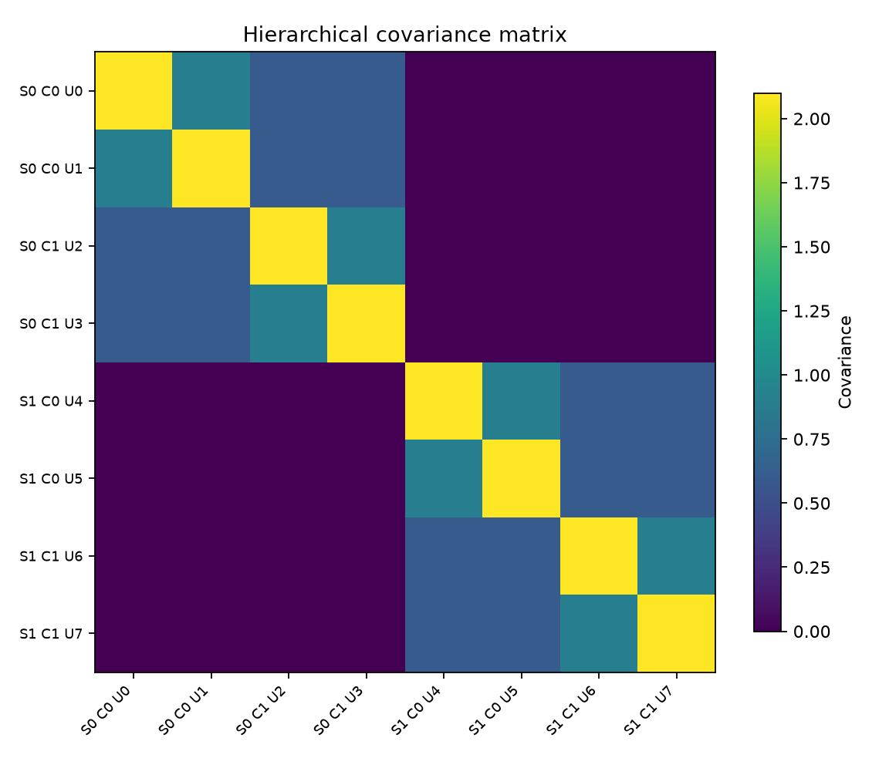
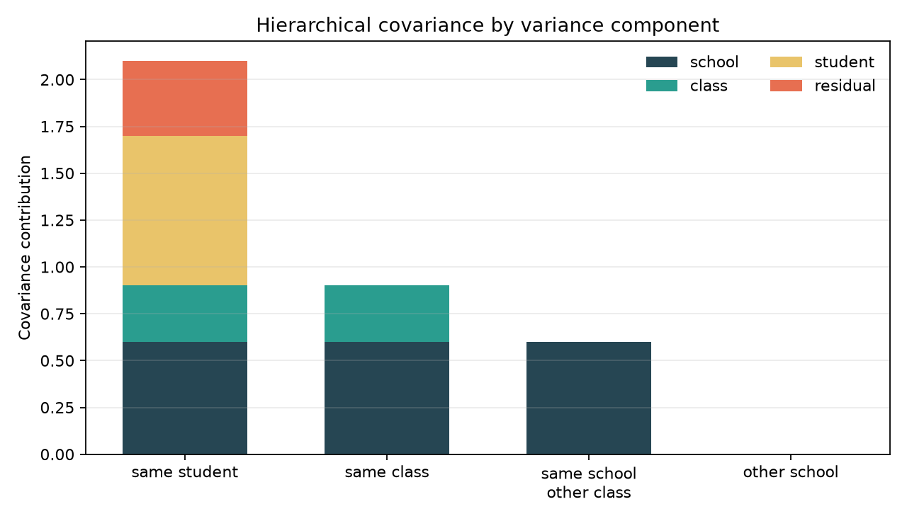
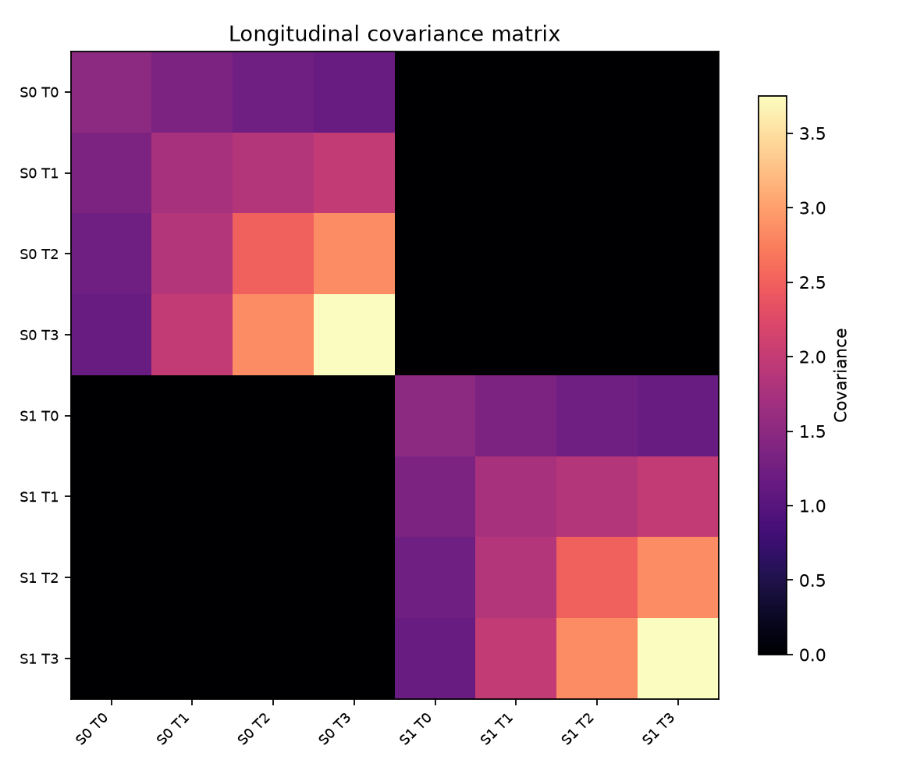
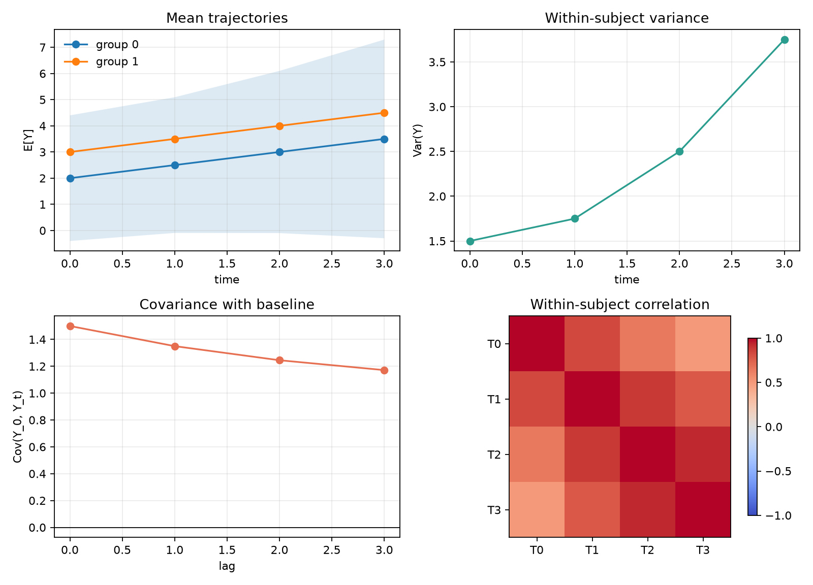

# Factor-first moments: a tutorial

This tutorial uses the factor-first API to derive and inspect symbolic response
moments for two common model families:

1. a **hierarchical model** with schools, classes, and students;
2. a **longitudinal model** with subjects observed over time.

The package derives moments symbolically. The plots below substitute concrete
parameter values into those symbolic expressions; they are not model fits.

## Setup

```python
import sympy as sp
import symlmm as sl
```

All index symbols are nonnegative integers. The factor declarations own their
index symbols; no global `i` or `t` is hardcoded.

```python
i = sp.Symbol("i", integer=True, nonnegative=True)
t = sp.Symbol("t", integer=True, nonnegative=True)
```

## Part 1: hierarchical model

### Model

A student belongs to one class, and a class belongs to one school. The
hierarchical model is

$$
Y_{s,c,u} = \beta_0 + b_s + b_{c(s)} + b_{u(c)} + \varepsilon_{s,c,u},
$$

with independent variance components

$$
b_s \sim N(0,\sigma_s^2), \qquad
b_{c(s)} \sim N(0,\sigma_c^2), \qquad
b_{u(c)} \sim N(0,\sigma_u^2), \qquad
\varepsilon \sim N(0,\sigma_\varepsilon^2).
$$

The response covariance between two observations is

$$
\operatorname{Cov}(Y_a,Y_b)
= \sigma_s^2\,\mathbf{1}[s_a=s_b]
+ \sigma_c^2\,\mathbf{1}[c_a=c_b]
+ \sigma_u^2\,\mathbf{1}[u_a=u_b]
+ \sigma_\varepsilon^2\,\mathbf{1}[a=b].
$$

The key point is that the nested factor path is full ancestry:
`student` is labeled `school:class:student`, not only `class:student`.

```python
school = sl.Group("school", index=sp.Symbol("s", integer=True))
klass = sl.Nested("class", "school")
student = sl.Nested("student", "class")

beta0 = sp.Symbol("beta0")
s2_school, s2_class, s2_student, s2 = sp.symbols(
    "s2_school s2_class s2_student s2", positive=True
)

hier = sl.LMM(
    fixed=sl.Fixed(intercept=beta0),
    random=[
        sl.RandomEffects(group=school, intercept=True, cov=sl.Scalar(s2_school)),
        sl.RandomEffects(group=klass, intercept=True, cov=sl.Scalar(s2_class)),
        sl.RandomEffects(group=student, intercept=True, cov=sl.Scalar(s2_student)),
    ],
    residual=sl.IID(var=s2),
    groups=[school, klass, student],
    n=8,
)
```

Resolved factors carry their full component path:

```python
for factor in hier.factors():
    print(factor.name, factor.label, factor.components)

# school school ('school',)
# class school:class ('school', 'class')
# student school:class:student ('school', 'class', 'student')
```

### Dense example

Eight students, two schools, two classes per school, two students per class:

```python
dense = hier.dense(
    school=[0, 0, 0, 0, 1, 1, 1, 1],
    **{"class": [0, 0, 1, 1, 0, 0, 1, 1]},
    student=[0, 1, 2, 3, 4, 5, 6, 7],
)
```

The full covariance matrix has the expected block structure. With
$\sigma_s^2=0.6$, $\sigma_c^2=0.3$, $\sigma_u^2=0.8$, and
$\sigma_\varepsilon^2=0.4$:

```python
values = {
    s2_school: 0.6,
    s2_class: 0.3,
    s2_student: 0.8,
    s2: 0.4,
}
V = dense.matrix_covariance().subs(values)
```



The diagonal is $0.6+0.3+0.8+0.4=2.1$. Students in the same class have
covariance $0.6+0.3=0.9$; students in different classes of the same school
have covariance $0.6$; students in different schools have covariance $0$.

### Block moments

A block is the observation set belonging to one factor level:

```python
school0 = dense.block(school, 0)
class0 = dense.block(klass, 0)

school0.size()          # 4
class0.size()           # 2
school0.mean()          # fixed-effect mean for the four school-0 rows
class0.covariance()     # covariance of the two class-0 rows
```

For a nested hierarchy, a class block is a sub-block of its school block. The
same `Block` methods work for nested, crossed, ancestor, and descendant
levels.

### Variance-component decomposition

`covariance_terms` splits a covariance into named random-effect contributions
plus the residual:

```python
dense.covariance_terms(0, 1)
# {'school': s2_school,
#  'school:class': s2_class,
#  'school:class:student': 0,
#  'residual': 0}
```



Partial covariance removes selected components:

```python
dense.partial_covariance(0, 1, exclude=("school",))
# s2_class

dense.partial_covariance(0, 1, exclude=("school:class",))
# s2_school
```

This is the algebra behind questions such as “what is the remaining
covariance after accounting for the school-level variance component?”

## Part 2: longitudinal model

### Model

For subject $i$ at time $t$:

$$
Y_{it} = \beta_0 + \beta_1 t + \beta_2 g_i
         + b_{0i} + b_{1i} t + \varepsilon_{it},
$$

with

$$
\begin{pmatrix} b_{0i} \\ b_{1i} \end{pmatrix}
\sim N\left(0,\begin{pmatrix}\tau_0^2 & 0 \\ 0 & \tau_1^2\end{pmatrix}\right),
\qquad
\operatorname{Cov}(\varepsilon_{it},\varepsilon_{is})
= \sigma^2 \rho^{|t-s|}.
$$

The marginal covariance is

$$
\operatorname{Cov}(Y_{it},Y_{is})
= \tau_0^2 + \tau_1^2 t s + \sigma^2 \rho^{|t-s|}.
$$

The model uses a `PanelView` to expose the time axis:

```python
subject = sl.Group("subject", index=i)
time = sl.Covariate("time", index=t)
visit = sl.Position("time", index=t)
group = sl.Covariate("group")

beta0, beta1, beta2 = sp.symbols("beta0 beta1 beta2")
tau0, tau1, sigma2, rho = sp.symbols("tau0 tau1 sigma2 rho", positive=True)

long = sl.LMM(
    fixed=sl.Fixed(
        intercept=beta0,
        slopes={time: beta1, group: beta2},
    ),
    random=[
        sl.RandomEffects(
            group=subject,
            intercept=True,
            slopes=(sl.RandomSlope(time),),
            cov=sl.Diagonal([tau0, tau1]),
        )
    ],
    residual=sl.AR1(
        group=subject,
        coordinate=time,
        var=sigma2,
        rho=rho,
    ),
    coordinate="time",
    n=8,
)

dense_long = long.dense(
    subject=[0, 0, 0, 0, 1, 1, 1, 1],
    time=[0, 1, 2, 3, 0, 1, 2, 3],
    group=[0, 0, 0, 0, 1, 1, 1, 1],
)

panel = dense_long.panel(subject, visit)
panel.response_matrix().shape      # (2, 4)
panel.position_count()             # 4
```

### Entry moments

```python
panel.entry_mean(0, 1)
# beta0 + beta1

panel.entry_mean(1, 1)
# beta0 + beta1 + beta2

panel.entry_covariance(0, 2, 2)
# sigma2 + tau0 + 4*tau1

panel.entry_covariance(0, 0, 2)
# rho**2*sigma2 + tau0

panel.entry_cross_covariance(0, 1, 1, 1)
# 0  (different subjects)
```

The first two results show the group effect $\beta_2$; the third is the
random-intercept plus random-slope variance at $t=2$; the fourth is the AR(1)
decay plus the shared random intercept.

### Covariance structure



The two 4-by-4 diagonal blocks are within-subject covariance matrices. The
off-diagonal blocks are zero because subjects are independent.



Top left: mean trajectories for the two groups. Top right: variance grows with
time because the random slope contributes $\tau_1^2 t^2$. Bottom left:
covariance with baseline decays through the AR(1) residual term and the random
intercept. Bottom right: within-subject correlation matrix.

### Term decomposition

```python
dense_long.covariance_terms(1, 2)
# {'subject': tau0 + 2*tau1,
#  'residual': rho*sigma2}
```

The subject term contains both the random intercept and the random slope;
`residual` is the AR(1) contribution.

## Part 3: blackboard notation

`panel.symbols()` returns a blackboard facade for textbook-style expressions.
For the longitudinal panel:

$$
E[Y_{it}] = X_{it}\beta, \qquad
\operatorname{Var}(Y_{it}) = [V_i]_{tt}, \qquad
\operatorname{Cov}(Y_{it},Y_{is}) = [V_i]_{ts}.
$$

```python
syms = panel.symbols()

syms.i                      # subject index i
syms.t                      # time index t

syms.E(syms.Y[0, 0])        # beta0
syms.Var(syms.Y[0, 0])      # sigma2 + tau0
syms.Cov(syms.Y[0, 0], syms.Y[0, 2])
# rho**2*sigma2 + tau0
```

Group rows use `Y[group, :]`:

```python
syms.E(syms.Y[0, :])
# [beta0, beta0 + beta1, beta0 + 2*beta1, beta0 + 3*beta1]

syms.Var(syms.Y[0, :])
# 4 x 4 within-subject covariance matrix
```

Random-effect moments use `b[i]`:

```python
syms.b[syms.i]              # b_i
syms.Var(syms.b[syms.i])    # diag(tau0, tau1)
```

For the hierarchical model, the blackboard’s `Y` row/column notation needs a
panel position axis. Group-level effects are still available directly:

```python
hs = hier.panel(school, None).symbols()

hs.b[hs.i]                  # b_school
hs.Var(hs.b[hs.i])          # [[s2_school]]
hs.G                        # same school-level covariance
hs.E(hs.b[hs.i])            # zero matrix
```

This separates two uses of the same facade:

- `b[i]` and `G` describe random-effect vectors for a factor;
- `Y[i, t]`, `E`, `Var`, and `Cov` describe response moments when a panel
  position axis exists.

## Part 4: symbolic and numeric use

The model objects are symbolic. `dense` adds concrete observation columns and
is required for dense entry moments and plots. The symbolic block API is
available without observation data:

```python
hier.block(school, sp.Symbol("g", integer=True)).mean()
# symbolic fixed-effect mean: X_school:g @ beta

hier.block(school, sp.Symbol("g", integer=True)).covariance()
# symbolic block covariance
```

Symbolic panel entry moments are a follow-up item; see
[`docs/superpowers/plans/2026-11-18-symlmm-symbolic-panel-entries.md`](../superpowers/plans/2026-11-18-symlmm-symbolic-panel-entries.md).

## Reproduce the figures

From the repository root:

```bash
uv run --with matplotlib python docs/tutorials/generate_figures.py
```

The script writes the four PNGs under `docs/tutorials/figures/`. Matplotlib is
used only for the tutorial figures and is not a runtime dependency of
`symlmm`.
